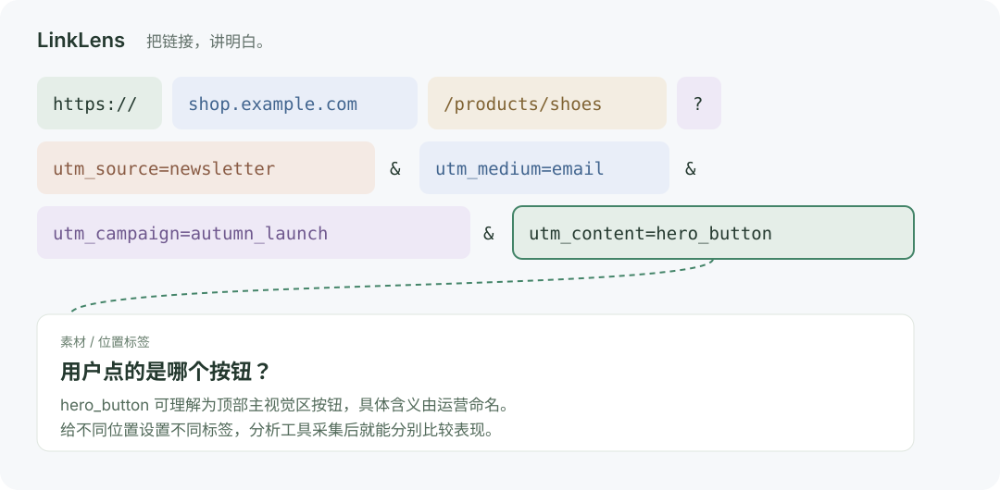

<div align="center">

# LinkLens · 广告监测链接解读

**把广告投放中的监测链接拆开，讲清点击怎么记录、转化怎么关联、结果回给谁。**

面向广告运营、商业化产品经理和技术接入人员的中文 Codex Skill。

[快速开始](#快速开始) · [看看效果](#看看效果) · [能解释什么](#能解释什么) · [使用边界](#使用边界)

</div>

## 这是广告行业里的什么工具？

**这是一个广告监测与归因接入的讲解助手。** 它帮助你看懂投放后台、媒体接入文档和广告主监测模板里的长链接，适合新人学习、产品梳理和接入沟通。

广告投出去后，媒体、广告平台、广告主需要交换信息：谁点了广告，来自哪条计划，后续有没有注册或下单，结果应该通知谁。这些信息经常放在监测链接和回传参数里。

LinkLens 就是把这些链接拆开，说明每个字段在业务链路里起什么作用。

| 广告链路环节 | 你通常想弄明白什么 |
| --- | --- |
| 点击监测：记录广告点击 | 谁发给谁？设备、时间、计划和创意参数分别做什么？ |
| 转化归因：关联点击与后续结果 | OAID、IDFA、点击编号等提供什么匹配线索？链接本身能说明到哪一步？ |
| 广告主 → 广告平台的转化回传 | 广告主如何把注册、支付等结果交给平台？事件字段是什么意思？ |
| 广告平台 → 媒体的效果回调 | 平台如何通知媒体？反馈地址里带了哪些关联信息？ |
| 落地页、跳转与 App 唤起 | 哪一段负责记录，哪一段是用户最终去的地址？ |

“归因”就是尝试把后续转化和前面的广告接触关联起来；“回传 / 回调”是系统按约定通知另一方结果。具体规则以各平台协议为准。

它的作用是**帮助理解和沟通接入**，不承担投放执行、真实归因计算或线上故障定责。

## 一条广告链接，不该靠猜

你可能见过这样的地址：

```text
https://track.example.com/click?click_id=__CLICK_ID__&oaid=__OAID__&creative_id=__CREATIVE_ID__
```

知道 `utm_source` 翻译成“来源”，还不够。你真正想知道的是：

- 这是什么网站？这个地址是页面、监测接口，还是跳转入口？
- 这条链接在业务里起什么作用，谁把什么信息传给谁？
- 参数由谁填写，内容是什么意思，改掉会有什么影响？
- IDFA、IMEI、OAID、MD5 这些缩写，到底在说什么？

**LinkLens 把这些问题一起讲清楚。** 先查网站和官方规则，再用大白话解释；查不到的地方明确说不知道。

## 看看效果



*上图为输出形式示意，使用保留的演示域名；不是某个真实商家的广告数据。实际交互依赖宿主的可视化能力。*

例如点击 `utm_content=hero_button`，会这样解释：

> **用来区分：用户点了哪一个位置。**  
> `hero_button` 可以理解为“顶部主视觉区按钮”，具体对应哪个按钮由运营命名。  
> 顶部按钮填 `hero_button`、底部填 `footer_button`，分析工具采集后就能分别看表现；两处填同一个值，就难以区分。

不止告诉你“是什么”，还告诉你“拿它干什么”。

## 快速开始

### 1. 安装到 Codex

在 Codex 中发送：

```text
请使用 skill-installer，安装这个 GitHub 仓库中的 Skill：
https://github.com/ChengruiLabs/link-business-explain
```

也可以手动安装。下载仓库，把其中的 `SKILL.md`、`agents/` 和 `references/` 放进：

```text
~/.codex/skills/link-business-explain/
```

自定义了 `CODEX_HOME` 时，放进该目录下的 `skills/link-business-explain/`。

### 2. 粘贴链接

```text
$link-business-explain
解释这条链接：
https://shop.example.com/products/shoes?utm_source=newsletter&utm_medium=email&utm_campaign=autumn_launch&utm_content=hero_button
```

### 3. 按需要追问

```text
只讲业务用途，简单一点。
```

```text
把每个参数拆开，用不同颜色区分，点击后连线解释。
```

```text
这里的 OAID 和 IDFA 分别是什么？为什么要带它们？
```

## 能解释什么

| 场景 | 重点解释 |
| --- | --- |
| 推广落地页与 UTM 参数 | 来源、媒介、活动、素材标签如何帮助复盘 |
| 广告监测与宏模板 | 谁填宏、设备与广告编号怎么用、模板和实际请求的区别 |
| 回传与反馈地址 | 谁通知谁、关联什么记录、与用户跳转有什么区别 |
| 多层 URL 与编码 | 外层入口和内层地址分别做什么，特殊字符为什么要编码 |
| 常见缩写 | 中文名称、真实含义，以及在当前链接里的作用 |

默认输出**横向拆块，放不下自动换行**，按类别用淡色区分。点哪一块，就看哪一项的简短解释；有嵌套链接时可以继续展开。宿主不支持交互时，改用简洁文字或表格。

## 需要什么

- 能加载 `SKILL.md` 的 Codex 环境。
- 可用的网页搜索或浏览能力，用于核实网站身份和官方规则。
- 彩色拆块、连线交互需要宿主提供可视化能力。仅安装本 Skill 不会额外安装浏览器或可视化插件。

这个仓库是一套给 AI 的工作指令，**不是独立网站或浏览器插件**，也不包含额外的模型服务。联网与模型使用方式遵循你现有的宿主配置。

## 使用边界

- 不直接访问输入的监测、回调或签名链接，避免无意制造点击或上报。
- 不把整条链接里的令牌、签名、设备标识等实际值发给搜索引擎；内部地址不外发搜索。
- 优先查官方资料，区分链接里的事实、文档定义和业务推测。
- 不能保证识别任意网站；私有参数、事件码和业务编号可能需要对应平台的协议。
- 字段存在不代表请求成功、事件发生或归因成立。本 Skill 不替代生产日志诊断。

涉及客户或公司数据时，请先脱敏再分享。AI 解读仍需结合接入文档判断。

## 仓库结构

```text
link-business-explain/
├── SKILL.md                 # 核心工作方式
├── agents/openai.yaml       # Codex 中的名称与调用提示
├── references/research.md   # 官方资料入口与解读边界
├── docs/preview.svg         # 拆块讲解形式示意
├── README.md
└── LICENSE
```

## 一起把链接讲明白

欢迎提 Issue，告诉我们哪些参数没讲清楚、哪些官方资料可以补充，或分享你希望支持的场景。请使用虚构或已脱敏的链接，不要提交真实密钥、客户数据和内部地址。

如果它帮你少猜了几个参数，欢迎点一个 **Star ⭐**，也方便以后找到。

## English

**LinkLens is a Chinese-first Codex Skill for understanding advertising tracking URLs and attribution integrations.** It focuses on click monitoring, conversion reporting, media callbacks, device identifiers, and nested landing-page URLs. It researches official documentation, then explains what each part means, who supplies it, how it is used, and what changing it may affect. Interactive hosts can show colored URL segments with linked explanations; text is the fallback. This is a skill package, not a standalone app.

## License

[MIT](LICENSE)
